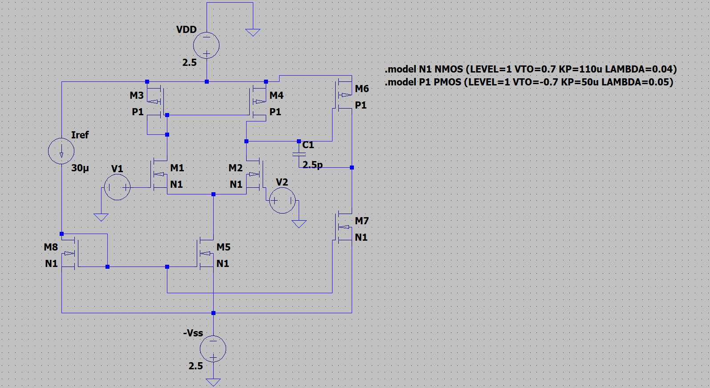
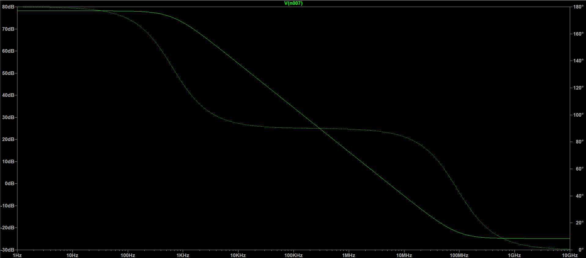
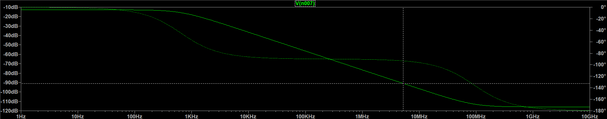
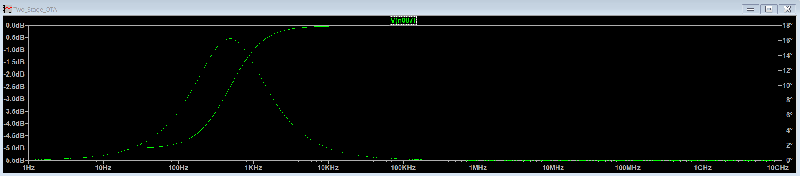
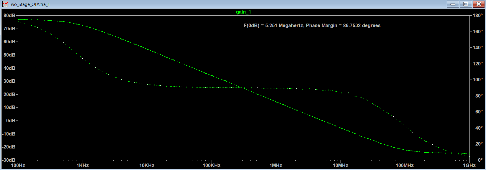
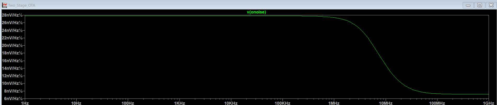
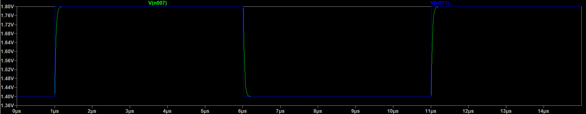

# Two-Stage CMOS OTA Design and Simulation

A two-stage CMOS Operational Transconductance Amplifier (OTA) designed and simulated using LTspice 26.0.2.

## Project Overview

This project covers the design and simulation of a two-stage CMOS OTA, including transistor sizing, DC operating point, AC gain and phase response, transient analysis, noise analysis, input common-mode range, and output swing.

## Design Specifications

| Parameter | Target |
|---|---|
| Supply Voltage | ±2.5 V |
| DC Voltage Gain | > 5000 V/V (> 73.98 dB) |
| Unity-Gain Bandwidth | 5 MHz |
| Phase Margin | ≥ 60° |
| Load Capacitance | 10 pF |
| Slew Rate | > 10 V/µs |
| Output Voltage Swing | ±2 V |
| Input Common-Mode Range | −1 V to +2 V |
| Maximum Power Dissipation | 2 mW |
| Miller Compensation Capacitor | 2.5 pF |
| Reference Current | 30 µA |
| Minimum Channel Length | 1 µm |

## Circuit Architecture



### First Stage: Differential Amplifier

- `M1`, `M2`: NMOS differential input pair
- `M3`, `M4`: PMOS active current-mirror load
- `M5`: NMOS tail-current source

### Second Stage: Common-Source Amplifier

- `M6`: PMOS gain transistor
- `M7`: NMOS current-source load

### Biasing and Compensation

- `M8`: Diode-connected NMOS bias transistor
- `Iref`: 30 µA reference current
- `C1`: 2.5 pF Miller compensation capacitor

## MOSFET Model Parameters

| Parameter | NMOS | PMOS |
|---|---:|---:|
| Threshold Voltage | +0.7 V | −0.7 V |
| Channel-Length Modulation | 0.04 V⁻¹ | 0.05 V⁻¹ |
| Process Transconductance Parameter | 110 µA/V² | 50 µA/V² |
| Parameter Tolerance | ±10% | ±10% |

## Design Equations

### MOSFET Drain Current

```text
ID = 0.5 × μCox × (W/L) × VOV²
VOV = VGS − Vth
```

### Voltage Gain

```text
First-stage gain:
Av1 = −gm2 × (ro2 || ro4)

Second-stage gain:
Av2 = −gm6 × (ro6 || ro7)

Overall gain:
Av0 = Av1 × Av2

Gain in dB:
Gain_dB = 20 × log10(abs(Av0))
```

### Unity-Gain Bandwidth

```text
UGBW ≈ gm1 / (2 × π × C1)
```

## DC Operating Point Results

| Parameter | Simulated Result |
|---|---:|
| VDD | +2.5 V |
| VSS | −2.5 V |
| Reference Current | 30 µA |
| M1 Drain Current | 15.04 µA |
| M2 Drain Current | 15.51 µA |
| M5 Drain Current | 30.55 µA |
| M6 Drain Current | 152.40 µA |
| M7 Drain Current | 152.40 µA |
| Estimated Power Dissipation | 1.065 mW |

## Simulation Waveforms

### 1. AC Gain and Phase Response



### 2. Common-Mode Response



### 3. Power-Supply Rejection Ratio (PSRR)



### 4. Frequency Response Analysis (FRA)



### 5. Noise Analysis



### 6. Transient Response



## AC Analysis

AC analysis was performed to examine the amplifier's gain, bandwidth, and phase response.

| Parameter | Target | Reported Result |
|---|---:|---:|
| Low-Frequency Gain | > 73.98 dB | Approximately 78–80 dB |
| Unity-Gain Frequency | 5 MHz | Approximately 5.235 MHz |
| Phase Margin | ≥ 60° | Approximately 86.75° reported from FRA |

Phase margin should be confirmed using the corresponding loop-gain or frequency-response measurement.

## Noise Analysis

The noise simulation examines the noise spectral density over frequency.

**Reported results:**

- Low-to-mid-frequency noise density: approximately `28 nV/√Hz`
- Reported high-frequency level: approximately `7 nV/√Hz` beyond 1 MHz

## Transient Analysis

Transient simulation was used to observe the output response to pulse inputs.

**Reported average transition slopes:**

- Rising transition: `0.285 V/µs`
- Falling transition: `0.268 V/µs`

These average slopes do not demonstrate that the required slew rate of `10 V/µs` has been achieved.

## Output Swing Analysis

The output swing was investigated using an open-loop DC sweep.

### Test Setup

- `V1`: Fixed DC bias of 1.62 V
- `V2`: Swept from 1.58 V to 1.66 V
- Sweep step: 1 mV

```text
.dc V2 1.58 1.66 0.001
```

### Reported Output Limits

- Negative output limit: approximately −2.5 V
- Positive output limit: approximately +2.35 V to +2.40 V

These are observed open-loop limits and do not establish linear output swing over the full target range.

## Transient and Frequency Response Analysis (FRA)

Transient step response and Frequency Response Analysis were used to evaluate transient behavior and reported loop-stability metrics.

### Extracted Stability Metrics

- Unity-Gain Bandwidth (UGBW / F(0 dB)): `5.251 MHz`
- Phase Margin (PM): `86.7532°`
- Dynamic Stability: The reported phase margin suggests good stability, but overshoot and ringing must be verified from the transient waveform.

## Input Common-Mode Range (ICMR) Analysis

The input common-mode range defines the input voltage boundaries over which the differential input transistors remain in the required operating region.

### Extracted ICMR Limits

- **Lower Common-Mode Limit (ICMR Min):** `0 V`
- **Upper Common-Mode Limit (ICMR Max):** `2.35 V`
- **Operating Bias Point:** `1.62 V DC`

The reported range does not fully establish compliance with the target ICMR of `−1 V to +2 V`.

## Repository Structure

```text
Two_Stage_CMOS_OTA/
├── README.md
├── images/
│   ├── schematic.png
│   ├── ac_waveform.png
│   ├── ac_waveform_Common_mode.png
│   ├── ac_waveform_PSRR.png
│   ├── FREQUENCY_RESPONSE.png
│   ├── NOISE_waveform.png
│   ├── transient_waveform_m.png
│   └── transient_waveform.png
├── ltspice/
│   ├── Two_Stage_OTA.asc
│   └── Two_Stage_OTA.net
├── calculations/
│   ├── AC_Gain_Result.txt
│   ├── DC_Operating_Point_Results.txt
│   ├── ICMR_analysis.txt
│   ├── NOISE_ANALYSIS.txt
│   ├── OUTPUT_SWING_REPORT.txt
│   └── TRANSIENT_ANALYSIS.txt
└── report/
    └── Final_Design_Report.pdf
```

## How to Run the Project

1. Install LTspice.
2. Open `ltspice/Two_Stage_OTA.asc`.
3. Select the required simulation directive: `.op`, `.ac`, `.tran`, `.noise`, or `.dc`.
4. Run the simulation and inspect the waveforms.
5. Save the important waveforms as PNG files in the `images/` folder.
6. Compare the measured results against the design specifications.

## Conclusion

This project implements a two-stage CMOS OTA using differential amplification, active loads, a second gain stage, current-reference biasing, and Miller compensation.

The reported simulations show promising gain, bandwidth, and power consumption. Slew rate, output swing, input common-mode range, and phase margin should be verified using their respective measurement setups before final specification compliance is claimed.